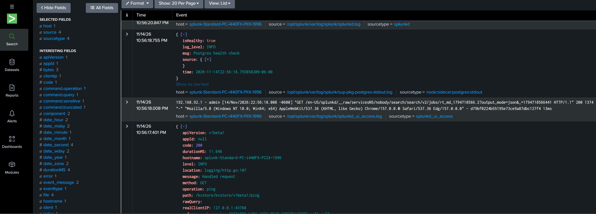

Splunk SIEM Home Lab

Project Overview

This project documents my hands-on experience building a Security Information and Event Management (SIEM) lab using Splunk Enterprise.

Lab Environment

SIEM Platform: Splunk Enterprise

Operating System: Ubuntu 24.04

Virtualization: EVE-NG / VMware

Endpoint: Windows 11 (installation in progress)

Objectives

Install and configure Splunk.

Understand SIEM monitoring and log analysis.

Collect Windows security event logs.

Investigate failed login attempts.

Practice basic SOC analyst workflows.

Work Completed

Installed Splunk on Ubuntu.

Accessed the Splunk Web interface.

Successfully executed a test search using internal Splunk logs.

Work in Progress

Installing Windows 11 endpoint.

Connecting Windows to Splunk.

Collecting and analyzing Windows Security Event Logs.

Future Investigation Exercises

Failed login analysis (Event ID 4625).

New user account creation (Event ID 4720).

Brute-force attack detection.
## Lab Evidence

### Splunk Internal Search

This screenshot shows Splunk Enterprise successfully running and returning internal log events.

Security incident investigation.

Learning Outcomes

This project helps me develop practical SIEM administration, security monitoring, log analysis, and SOC investigation skills.

Project Status: In Progress
